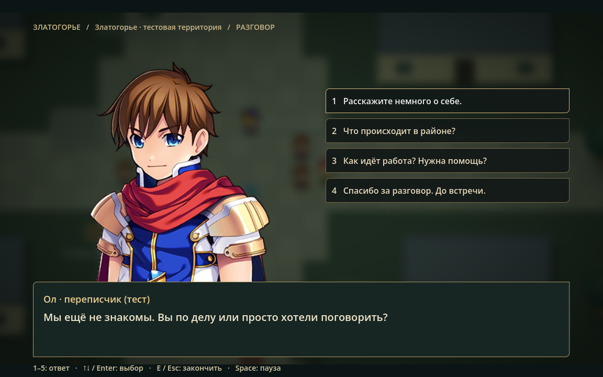
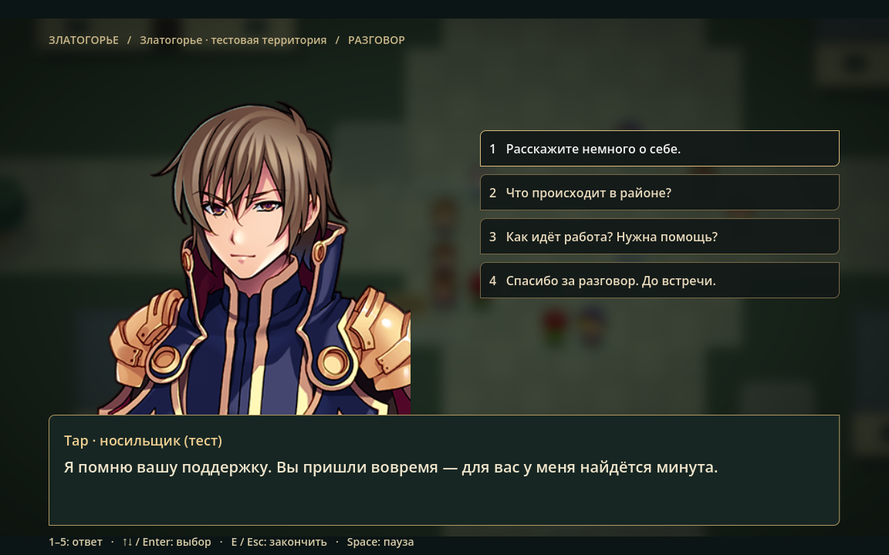
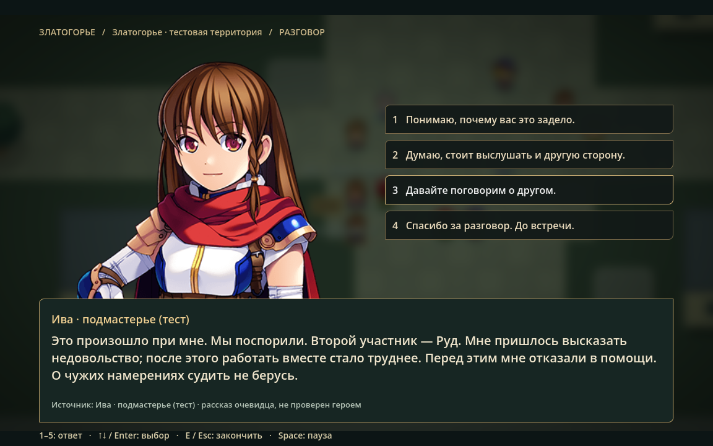
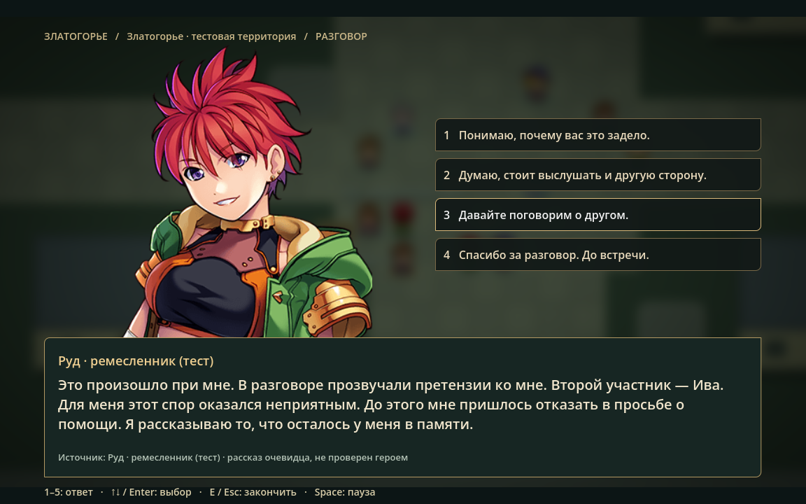
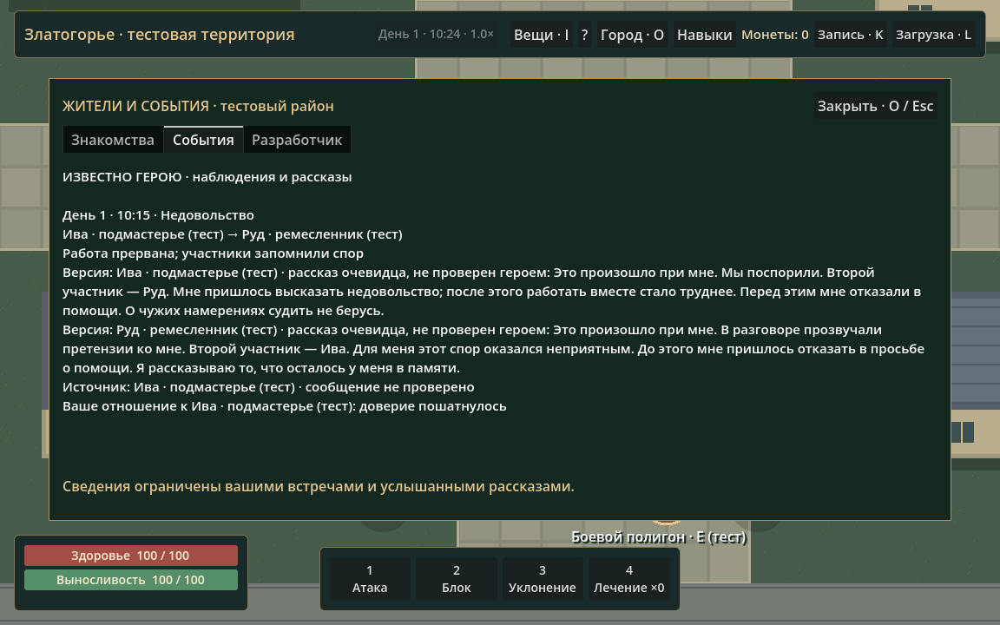

# Кинематографическая система разговоров

Проверено 21 октября 2026, Godot 4.7.2.stable.official.ed1daf0bf, Windows. Канон Златогорья, население и игровые предметы не изменены.

## Результат

E открывает отдельную мини-сцену поверх настоящей карты встречи. Обычный HUD скрывается; карта продолжает жить за мягким затемнением и размытием. Слева показана крупная иллюстрация NPC, справа — несколько тематических ответов, снизу — текущая реплика и её источник. Появление занимает 0,24 секунды. Длинная реплика увеличивает рамку по реальной высоте текста; пустое окно прежнего списка социальных функций в беседе больше не показывается.

Портреты взяты из имеющихся `asset/pictures/Actor1_*.png`. Это специальные крупные поясные рисунки MZ, не 48×48 игровые спрайты. Внешность тестовая. Полноразмерная замена подключается через определение данных; формат описан в [CONVERSATION_ART.md](CONVERSATION_ART.md).

## Темы и поведение

При открытии учитываются прежний контакт, направленное отношение NPC к герою, память о помощи, осторожность, общительность, раздражение, усталость и доступность собеседника. Незнакомый житель представляется иначе, чем доверяющий или недовольный.

Вначале предлагаются знакомство, новости, работа и, для торговцев, торговая реплика. Из темы работы доступны уместные просьбы и помощь; из темы события — вопрос об источнике, уточнение, поддержка или возражение. Они не собраны в одновременный список всех функций.

Повторные вопросы распознаются по теме, записанной в существующей памяти. Это работает и при следующем открытии, и после загрузки, пока воспоминание не вытеснено обычными ограничениями памяти. Сдержанный NPC ограничивает личные подробности. Недоверчивый или сильно раздражённый источник может отказаться обсуждать события; отказ сам сохраняется как состоявшийся разговор. При сильной агрессии возражение может закончить беседу. Усталый житель может попросить вернуться позже.

Просьба героя создаёт прежнюю настоящую `pending`-просьбу. NPC принимает решение в своей социальной симуляции; если ответ пришёл во время открытого разговора, реплика обновляется по реальному событию согласия или отказа. Интерфейс не выдаёт заранее выдуманное согласие.

## Знания и версии

Новости выбираются из памяти самого собеседника. Приоритет имеют собственные конфликты, затем наблюдавшиеся или услышанные события. Уточнение причины использует только известное этому NPC воспоминание о причинном событии; полная история мира и чужие приватные планы для ответа не читаются.

Разговор сохраняет:

- сам факт взаимодействия и реальные социальные последствия;
- тему и сказанный ответ с источником;
- рассказ о конкретном событии;
- отдельные версии разных источников;
- тип свидетельства и субъективную надёжность источника.

Версии прикреплены к существующему воспоминанию, а не к независимой таблице истины. Различаются личное наблюдение героя, непроверенный рассказ очевидца, пересказанный слух и сообщение, совпавшее с собственным наблюдением героя. Высокое доверие и совпадение двух рассказов сами по себе не превращают сообщение в проверенный факт. Для сверки проверяются идентификатор события, вид события и его участники.

Журнал O показывает источники и версии. Ответы о себе и работе также доступны в знаниях с пометкой, что содержание рассказа не проверено. Числовые психологические параметры и внутренняя интерпретация NPC остаются в явном режиме разработчика.

На одно воспоминание сохраняются не более трёх последних источников; текст одной версии ограничен 384 символами. Порядок поступления сохраняется отдельно, поэтому несколько разговоров в одной игровой минуте не теряются из-за сортировки JSON. Общие ограничения истории и памяти прежние.

## Три демонстрации из реальных состояний

### 1. Первое знакомство

Свежий мир, герой подошёл к Ол — тестовому переписчику. Контакта ещё нет. Его осторожность и низкая общительность дают сдержанное приветствие; вопрос о себе раскрывает профессию и ограничение личной темы. Повторный вопрос распознаётся.

### 2. Заработанное доверие

Герой трижды помог Тару реальным социальным действием: потратил выносливость, снизил его усталость и создал рабочую поддержку. Направленное доверие выросло по существующим правилам. Затем Тар также принял настоящую просьбу героя в автономной симуляции. Приветствие с благодарностью опирается на сохранившуюся память о помощи, а не на специальный сюжетный флаг.

### 3. Один конфликт — две версии

Мир симулировался без присутствия героя до первого действительного конфликта, максимум десять суток. В проверенном запуске событие №25 возникло в первый день в 10:15: Ива выразила недовольство Руду. Причиной служило существующее событие отказа в помощи №15, известное участникам.

Ива говорит о предшествующем отказе и собственном недовольстве. Руд описывает претензии к себе и свой прежний отказ выполнить просьбу. Это два взгляда на один идентификатор события. Герой пришёл позже, поэтому обе версии помечены как рассказы, не проверенные им лично. Участники, время и причина не назначены в диалоговом коде: другой мир может дать другое событие или отказ в разговоре.

Снимки сделаны из реального игрового viewport. Для подготовки примеров тест использует отдельные экземпляры мира: первый — новый, второй — после выполненной помощи, третий — после автономного социального прогона. Телепортация героя к участнику служит только ускорению графической проверки. Содержание событий, память и отношения получены игровыми действиями и симуляцией.

## Архитектура и файлы

Созданы:

- `scripts/simulation/conversation_session.gd` — временный контекст встречи, выбор тем, ответы, уточнения и реакция на реальные поздние решения NPC. Не содержит собственной шкалы доверия.
- `shaders/conversation_backdrop.gdshader` — самостоятельный ресурс шейдера фона фактической встречи.
- `scripts/ui/conversation_view.gd` — художественная сцена, фон из настоящей карты, портрет, адаптивная реплика, тематические ответы, плавное появление и управление фокусом.
- `scripts/data/conversation_art.gd` — назначение существующих иллюстраций и публичные представления профессий; поддерживает замену портрета через данные NPC.
- `tests/run_conversation_graphics.ps1` — графический прогон с проверкой ошибок; позволяет временно отключить запись GPU-кэша только на время QA в ограниченном окружении.
- `tests/conversation_test.gd` — модельные, интеграционные и графические проверки, подготовка реальных демонстраций.
- `docs/CONVERSATION_ART.md` и этот отчёт; снимки в `docs/screenshots/cinematic-*.png`.

Расширены:

- `scripts/simulation/social_simulation.gd` — проверяемый запрос конкретного известного источнику события, темы/ответы беседы, ограниченные свидетельства, сохранение и валидация. Все изменения мира проходят через прежние `check_action/execute`.
- `scripts/ui/social_ui.gd` — прежний журнал O и вход в отдельное представление беседы; отображение источников и версий.
- `scripts/world/main.gd` — остановка участников, переключение HUD, безопасный выход при угрозе, обработка клавиш до GUI, сохранённый доступ к прежним магазинам.
- `project.godot` — дополнительная клавиша пятого ответа. 1–4 продолжают работать как боевые быстрые слоты вне беседы.
- `tests/crowd_interaction_test.gd`, `tests/social_integration_test.gd` — обоснованное обновление UI-контракта: разговор стал полноэкранной сценой со скрытым HUD; психологическая отладка по-прежнему проверяется в журнале O.
- `tests/run_checks.ps1`, `docs/RUNNING.md`, `docs/GAME_DESIGN.md`.

## Время, безопасность и сохранения

Участники беседы стоят, остальные NPC, производство и мировое время обновляются прежним способом. Сам интерфейс не ставит мир на паузу. Space/P использует единственный GameClock. Пауза блокирует реплики с последствиями, но оставляет чтение, возврат к темам и выход.

Space обрабатывается до GUI: фокус на кнопке не превращает тактическую паузу в случайный ответ. Цифры во время беседы выбирают ответы, а не боевые действия. Угроза закрывает беседу и возвращает HUD/управление; прежняя защита от ускоренного боя сохранена.

Формат сохранения остаётся **6**, старые поля и миграции 1–5 сохранены. Новые поля в памяти и событиях необязательны. Источники, тип свидетельства, участники, размеры строк и коллекций проверяются при загрузке. Текущее положение в меню не сохраняется: после L разговор закрыт, а знания, отношения и последствия восстановлены. Пользовательский слот при тестах не используется.

## Проверки

Полный набор: **1020 успешных проверок, 0 ошибок игры** — прежние 970 и 50 проверок разговоров. Импорт Godot выполнен. Отдельный графический запуск выполнен через Direct3D 12 на NVIDIA RTX 3060.

Новые проверки охватывают:

- первое знакомство, сдержанный характер, содержательный ответ о профессии и повторные вопросы;
- доверие после реальной помощи и реакцию на реально принятое позднее решение;
- отказ источника без раскрытия неизвестных фактов;
- возникновение конфликта без героя, различия двух участников и сохранение обеих версий;
- отличие слуха от рассказа очевидца и сверки с личным наблюдением;
- ограничение количества источников и проверку некорректных данных;
- реальный дисковый save/load без повторения последствий;
- открытие по E, крупный портрет, паузу и остановку участников при продолжающемся времени;
- фокус, стрелки, номера ответов, Space при фокусе на кнопке, прерывание при угрозе;
- полноту длинных реплик и расположение элементов при 1152×720, 1280×720, 1920×1080;
- восстановление обычного интерфейса после загрузки и сохранность материалов.

Прежние проверки сохраняют торговлю кузнеца/торговца, имущество, производство, добычу, инвентарь, бой, навыки, толпу и социальную воспроизводимость десяти суток с тремя начальными состояниями. Диалоговые ответы не используют отдельную случайность; автономные решения сохраняют прежний PRNG мира.

Снимки разрешений: [1152×720](screenshots/cinematic-layout_1152x720.png), [1280×720](screenshots/cinematic-layout_1280x720.png), [1920×1080](screenshots/cinematic-layout_1920x1080.png).

В ограниченном окружении графического теста запись GPU-кэша давала `_save_to_cache: f.is_null()`. Проверка через `run_conversation_graphics.ps1 -DisableShaderCache` выполнена без этой ошибки: временный `override.cfg` отключает только запись кэша и удаляется в `finally`; проектная настройка и изображение не меняются. В обычном запуске игры кэширование остаётся включено.

В окружении Godot остаётся прежнее системное сообщение `Failed to read the root certificate store`. Оно не связано с GDScript или работой диалогов; иных ошибок в завершённых проверках нет.

## Известные ограничения

- Портреты пока поясные и временные; отдельных полноростовых рисунков, озвучки и смены мимики нет. Готов формат последующей замены иллюстраций.
- Реплики — ограниченный набор локальных шаблонов, обусловленных данными. Свободного текстового ввода и генератора произвольных историй нет.
- Тема новостей выбирает актуальное известное событие, а не предоставляет каталог всех когда-либо случившихся событий. Прошлое ограничено существующей памятью.
- Уже заданные вопросы могут забываться вместе с вытесненными воспоминаниями. Это не бесконечная отдельная история диалога.
- Решение NPC на просьбу приходит по существующему социальному такту и может задержаться из-за его текущих обстоятельств; интерфейс честно ждёт реального результата.
- Фоном служит текущая условная карта. Отдельные художественные интерьеры и новые игровые области в этом этапе не создавались.

## Как проверить вручную

F5 → подойти к жителю → E. Выбрать знакомство или работу, затем вернуться к другим темам. Вызвать паузу Space и убедиться, что чтение доступно, а действия остановлены. Для торговли обратиться к кузнецу/торговцу и выбрать соответствующую реплику.

Чтобы услышать версии спора, дать миру пожить, узнать новости у участника, затем найти другого участника и спросить о том же известном конфликте. Результат зависит от существующих событий, расположения, памяти и готовности персонажа говорить. O показывает полученные сведения и источники. K/L проверяют сохранение последствий.

Автотесты: `./tests/run_checks.ps1`. Снимки заново: `./tests/run_conversation_graphics.ps1` (в ограниченном окружении добавить `-DisableShaderCache`); тестовые файлы находятся только в `.godot/`.
