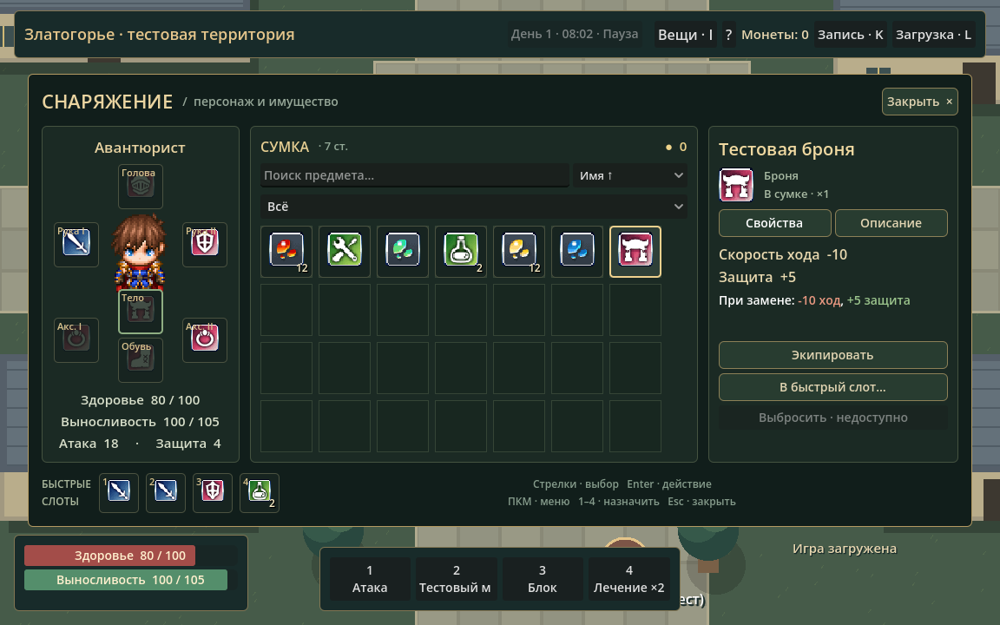
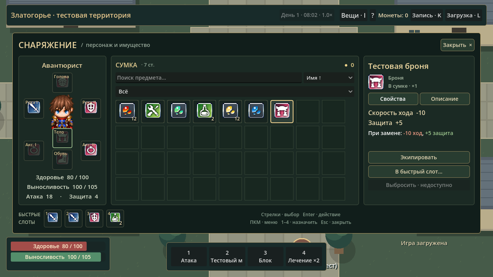
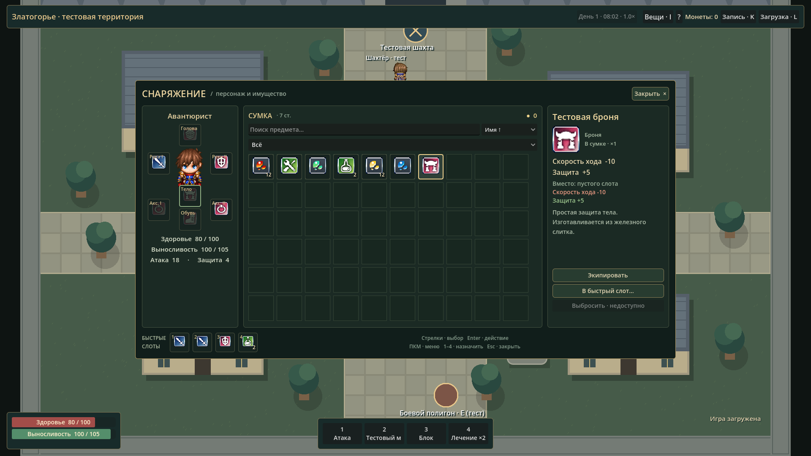
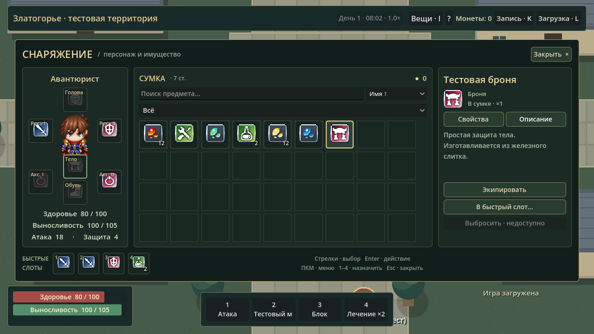
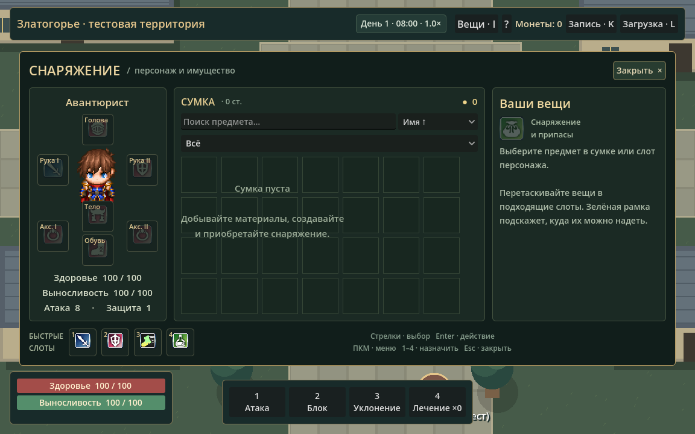

# Златогорье 0.5.1 — RPG-инвентарь

Существующий инвентарь получил новый визуальный интерфейс. Бой, экономика, производство, определения предметов и формат сохранений не заменялись.

## Что изменилось

- Три колонки: персонаж со спрайтом и семью узнаваемыми слотами, сетка сумки, карточка выбранной вещи.
- Существующие иконки из `asset/system/IconSet.png`, тёмные панели, золотые рамки выбора, подсветка совместимой экипировки, количества стеков и монеты.
- Фильтр шести категорий, поиск названия/описания, четыре режима сортировки, вертикальная прокрутка с клавиатурным фокусом.
- Карточка показывает категорию, бонусы, описание, требования при их наличии и изменения относительно текущей экипировки. При высоте 720 px свойства/описание переключаются вкладками; при 1080 px показаны вместе.
- ЛКМ выбирает; двойной щелчок и Enter выполняют применимое действие; ПКМ открывает контекстное меню. Стрелки/Tab перемещают фокус. Цифры 1–4 назначают выбранную вещь в быстрые слоты; игровые привязки вне окна сохранены.
- Drag-and-drop из сумки в экипировку и обратно, между аксессуарами, в быстрые слоты. Перестановка быстрых слотов работает и между новым окном и прежним HUD. ПКМ по быстрому слоту возвращает стандартное действие или очищает привязку.
- Отказы объясняются сообщениями и подсказками. Неподдерживаемое выбрасывание явно отключено, вещи не уничтожаются.
- Тестовая выдача скрыта из обычного окна. Открыть I, нажать Ctrl+Alt+D; доступна прежняя однократная выдача. Режим также включается аргументом `--developer`.

## Файлы

Новые: `scripts/ui/inventory_view.gd`, `inventory_slot.gd`, `inventory_bag.gd`, `item_icons.gd`; `tests/inventory_ui_test.gd`; снимки в `docs/screenshots/`.

Обновлены: `economy_ui.gd` (отдельное окно инвентаря, торговля сохранена), `quick_slot_button.gd` и `game_ui.gd` (перестановка быстрых слотов/справка), `main.gd` (маршрутизация и сообщения), `rpg_state.gd` (перестановка привязок/эквивалентных мест аксессуаров), общий запуск тестов и документация.

Независимый инвентарь не создавался. Все количества читаются из Inventory/PropertyLedger; изменение снаряжения/расходников использует прежнюю RPGState. Быстрые слоты содержат ссылки, не копии предметов. Сохранения остаются версии 4 с прежней поддержкой 1–3.

## Проверка

Godot **4.7.2.stable.official.ed1daf0bf**, Windows. Импорт, headless-тесты и настоящий рендер D3D12. **604 проверки, 0 провалов: все прежние 507 без изменения прежних тестов + 97 новых.**

Новые проверки охватывают пустую сумку, скрытый режим разработчика, конечный набор, иконки, выбор/двойной щелчок/Enter/ПКМ, изменение характеристик, совместимые/несовместимые слоты, возврат в сумку, аксессуары, назначения/перестановки быстрых слотов, лечение и его ограничения, запрет действий на паузе, сохранность материалов, сохранение/загрузку экипировки, поиск/категории/сортировку и прокрутку 120 временных тестовых определений. Эти определения создаются только в памяти теста; игровых данных и пользовательского слота они не меняют.

На 1152×720, 1280×720, 1920×1080 проверены границы окна, трёх колонок и слотов, отсутствие перекрытия полос состояния, чтение сравнения без прокрутки и компактные вкладки описания. Полученные снимки просмотрены визуально. Сохранения тестов — только отдельные файлы в `.godot/`, пользовательский слот не использовался.

Полный прогон:

```powershell
.\tests\run_checks.ps1 -GodotPath 'C:\путь\Godot_v4.7.2-stable_win64_console.exe'
```

Только новый набор и повторная съёмка:

```powershell
& $GodotPath --headless --path . --script res://tests/inventory_ui_test.gd
& $GodotPath --path . --script res://tests/inventory_ui_test.gd -- --capture
```

GDScript-ошибок в итоговом прогоне нет. В изолированном окружении остаётся прежнее системное сообщение Godot `Failed to read the root certificate store`; к инвентарю и локальной симуляции оно не относится.

## Ограничения

Выбрасывание отключено до реализации предметов на земле. Экипировка/лечение сохраняют прежние ограничения общей паузы и боевых действий. Редких требований у текущих предметов нет; карточка не вводит вымышленных классов/уровней. Иконки ресурсов являются временными обозначениями из существующего атласа; на спрайте персонажа надетые вещи отдельно не рисуются, их состояние показано в слотах.

## Снимки










