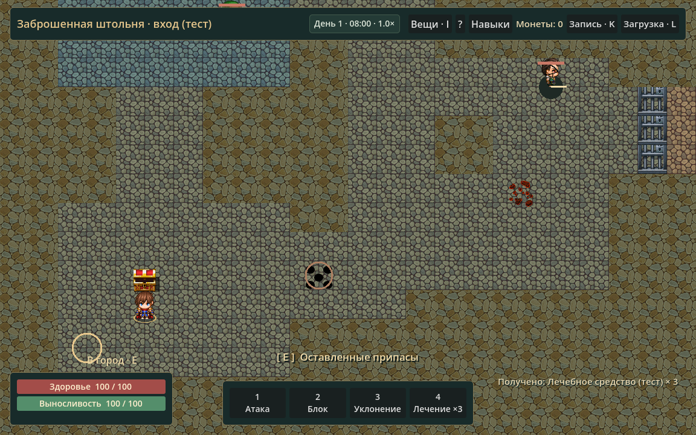
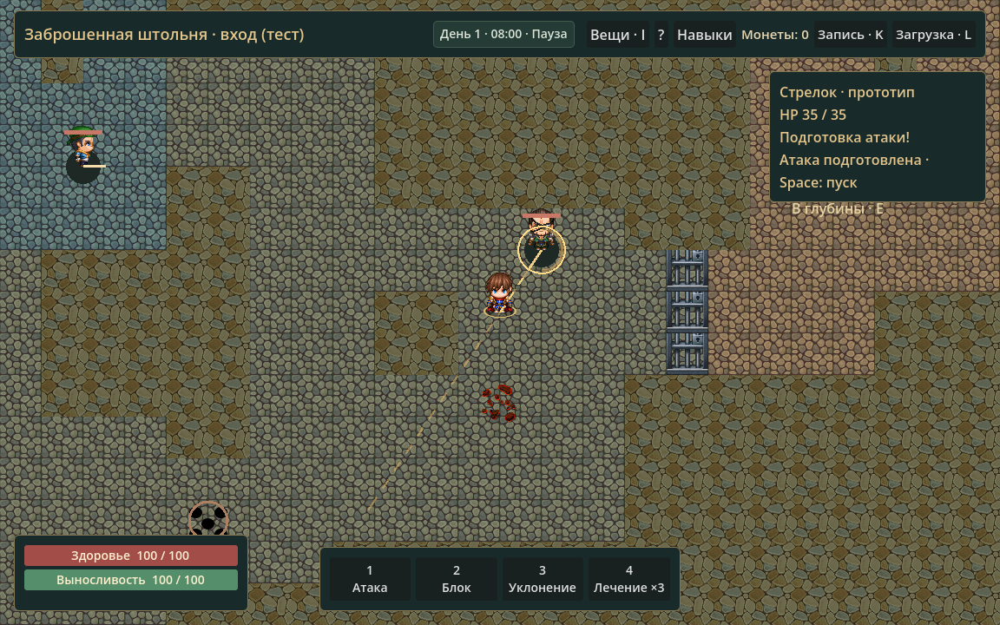
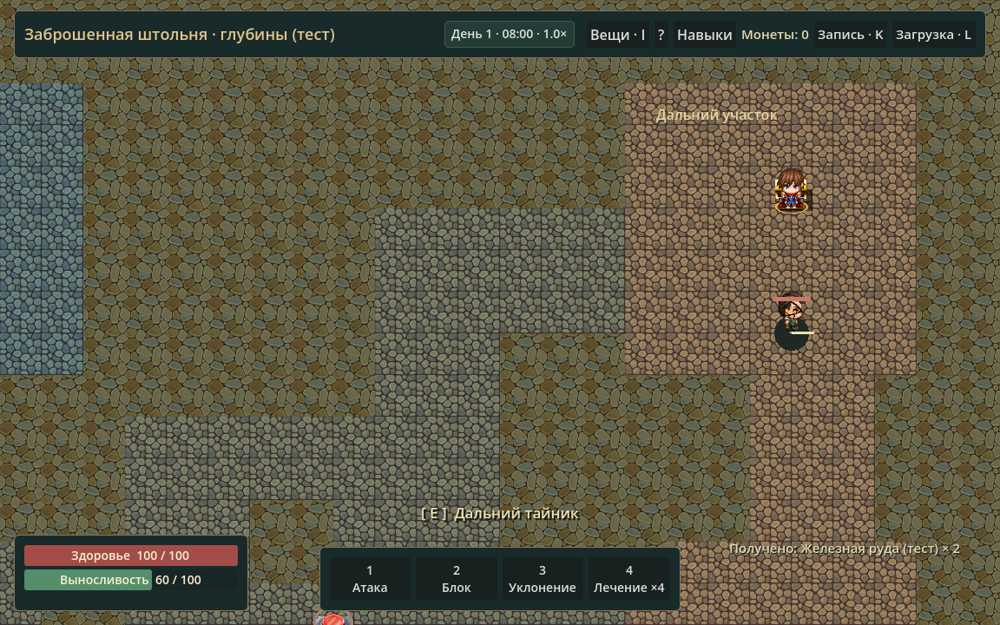
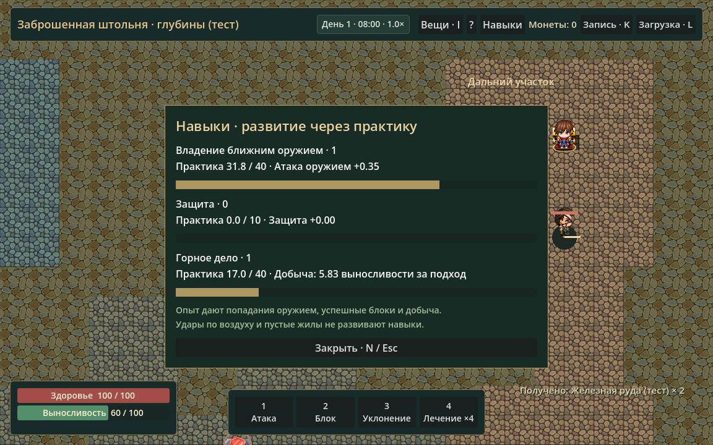

# Златогорье — этап 0.6

Первое конечное приключение добавлено к существующему проекту Godot 4.7.2. Боевые действия, NPC, производство, торговля, инвентарь и прежние предметные идентификаторы сохранены.

## Реализовано

- Два связанных участка тестовой заброшенной штольни с боковыми комнатами, развилками и реальными коллизиями. Открываемая ключом решётка, завал с воротом и обходная ветка, укрытия и визуально различимые участки.
- Четыре контейнера, две конечные жилы, четыре постоянных противника ближнего/дальнего боя, две однократные ловушки с предупреждением и обезвреживанием через E. Возвращение из глубин к входу и в город.
- Конечные припасы у входа позволяют пройти приключение без режима разработчика. Награды: существующие материалы, лечебные средства, оружие/броня, ключ и одно тестовое кольцо с +2 восстановления выносливости и +1 защиты. Нового канонического лора нет.
- Реестр имущества содержит владельцев контейнеров, ресурсов, противников и находок. Передачи: сундук → игрок, противник → находка → игрок, игрок → земля → игрок. При открытии или повторном входе запас не создаётся заново. Начальная инициализация области выполняется один раз и отражается в бюджете материалов.
- В инвентаре включено «Выбросить 1» и соответствующий пункт ПКМ. Надетую вещь сначала снять. Через E можно открыть находку и забрать имеющиеся предметы. Это работает и за пределами штольни.
- Противники штольни обнаруживают игрока с проверкой видимости, реагируют перед атакой, преследуют последнюю известную позицию, теряют цель и возвращаются. Стрелок выбирает дистанцию; в тесноте, где отступить нельзя, может стрелять с места. Стены и закрытые проходы блокируют попадания.
- Прежняя CombatSimulation параметризована областями и составом противников. Снаряды сохраняют свою область. При угрозе отключается ускорение; дополнительная проверка внутри фиксированных шагов не позволяет рассчитать серию ударов после обнаружения игрока в ускоренном кадре. Общая пауза GameClock сохранена.
- Три навыка практики: ближнее оружие, защита, горное дело. Опыт выдаётся за реальные попадания оружием, успешные блоки и успешную добычу; пустые действия не учитываются. Простые действия дают меньше опыта обученному персонажу. На противника действует конечный сохраняемый бюджет боевой практики.
- Владение оружием влияет на атаку, защита — на защиту, горное дело — на стоимость добычи в выносливости. Металл от навыка не появляется. Общего уровня/классов нет; для будущих ограничений профиля предусмотрена пустая точка расширения без расовых или магических значений.
- Окно навыков — N или кнопка в верхней строке.

## Сохранения

Формат 5 включает прежний мир, навыки/практику, обоих составов противников, снаряды с областью, открытые контейнеры, проходы, состояние/предупреждения ловушек, конечные запасы и находки на земле. Проверка выполняется до изменения текущей игры. Положение в открытом проходе проверяется с учётом сохранённого состояния коллизий.

Поддержаны форматы 1–4. Старый формат 0.5.1 проверен без новых владельцев и полей навыков; его имущество сохраняется, новая область начинается ещё не посещённой. Пользовательский слот тестами не использовался.

## Проверки

**722 проверки, 0 провалов**, Godot 4.7.2.stable.official.ed1daf0bf, Windows.

| Набор | Проверок | Результат |
|---|---:|---|
| Прежние регрессии: сцена, шахта, торговля, производство, NPC, бой, загрузка, RPG-инвентарь/UI | 612 | Пройдено |
| Штольня, контейнеры, ключ, конечные запасы, земля, переходы | 22 | Пройдено |
| Противники, ловушки, сохранения, безопасность ускорения, стены/области снарядов | 31 | Пройдено |
| Навыки, результативная практика, отсутствие бесплатного XP, старый формат 4 | 15 | Пройдено |
| Полная экспедиция с возвратом, ремеслом, продажей и сохранением | 42 | Пройдено |

Маршрутный тест следует рассчитанным путям и проверяет каждое небольшое смещение через CharacterBody2D.test_move с настоящими коллизиями сцены. Для воспроизводимости автоматическое движение мира в этом тесте остановлено; бои отдельно продвигаются фиксированными шагами той же CombatSimulation. В отдельных тестах проверяются обнаружение, возвращение, ловушки и временные ограничения. Это функциональная проверка, а не продолжительный ручной плейтест баланса.

Дополнительно проверены загрузка посреди предупреждения ловушки, непустая выброшенная вещь после загрузки, однократный подбор, открытый проход при сохранении внутри него, побеждённые противники после смены области, неподвижные снаряды другой области, отсутствие попаданий через решётку и прерывание 60× при выходе противника из-за угла внутри кадра.

Графическая проверка выполнена настоящим рендером D3D12 в сцене игры: вход, глубины, бой с подготовкой атаки/паузой, окно навыков и возвращение. Снимки просмотрены. Границы окна навыков проверены при 1152×720, 1280×720 и 1920×1080; прежние тесты раскладки также проходят. Использованы существующие RPG Maker MZ-ассеты проекта.

В итоговых журналах нет ошибок GDScript. Сохраняется прежнее системное сообщение изолированного окружения Godot о хранилище сертификатов; сеть для игры не требуется.

## Как проверить вручную

F5 → идти к «Заброшенная штольня · E» северо-западнее стартовой точки (816, 432) → E. Взять припасы из сундука у входа, экипировать через I. Северо-западный тайник даёт ключ; восточная решётка ведёт к спуску. В глубинах исследовать боковой склад, ворот, руду и дальний тайник. Возврат — юго-западные отметки. N показывает навыки, K/L сохраняют/загружают, Space ставит весь мир на паузу. Подробности — RUNNING.md, раздел этапа 0.6.

## Ограничения

- Две ручные области, фиксированные запасы, четыре противника; автоматического возрождения, случайного бесконечного лута и процедурной генерации нет.
- Противники/снаряды вне текущей области сохраняются без фонового боя. Мирные жители и производство продолжают прежнюю симуляцию.
- Ловушки однократные. Обезвреживание пока простое взаимодействие без отдельного навыка.
- До 512 записей находок на слот, включая подобранные. Это технический предел прототипа.
- Числа навыков, награды, имена и боевые параметры тестовые; длительный баланс ещё требует ручной игры.

## Основные файлы

Новые: `scripts/data/adit_location.gd`, `scripts/simulation/adventure_state.gd`, `scripts/simulation/skill_state.gd`, `scripts/world/adit_map.gd`, `scenes/locations/adit.tscn`, `scripts/ui/loot_ui.gd`, `scripts/ui/skill_ui.gd`, четыре автоматических набора `tests/adventure_*_test.gd`/`skill_test.gd` и `adventure_preview.gd`.

Расширены прежние WorldState, RPGState, CombatSimulation, PropertyLedger, Main, CombatView, интерфейс инвентаря и его сигналы, Input Map, маркеры города и документация. Проверка недоступного выбрасывания в старом UI-тесте обновлена для нового правила: действие запрещено на паузе.

Все проверки:

```powershell
.\tests\run_checks.ps1 -GodotPath 'C:\путь\Godot_v4.7.2-stable_win64_console.exe'
```

Графический прогон:

```powershell
& $GodotPath --path . --script res://tests/adventure_journey_test.gd -- --capture
& $GodotPath --path . --script res://tests/adventure_preview.gd
```

## Снимки








