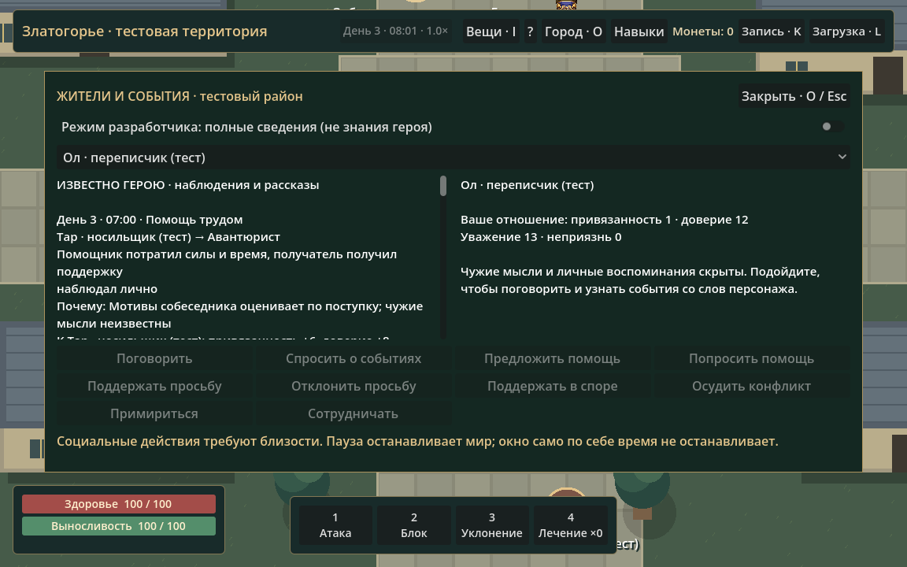
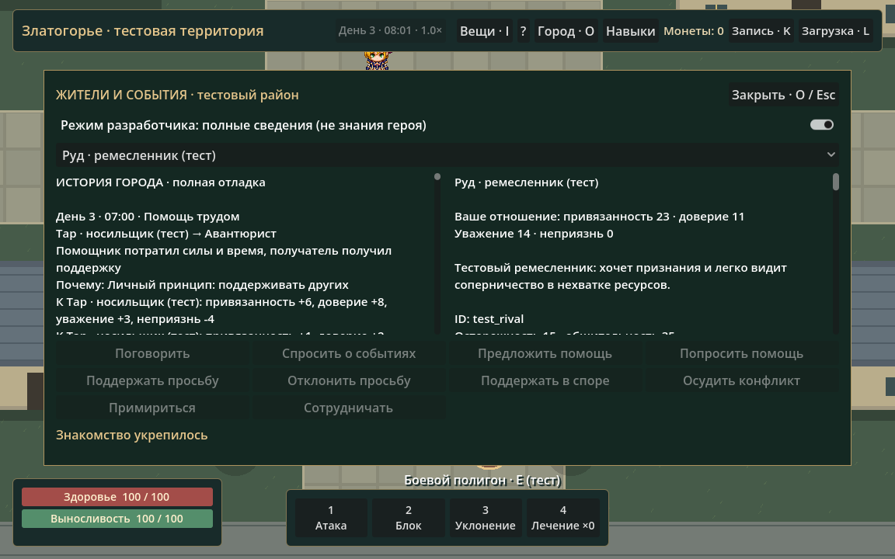

# Златогорье — этап 0.7: жители, память и социальные последствия

Дата: 20 октября 2026 года. Godot 4.7.2, Windows. Названия, имена, биографии и параметры новых жителей — тестовые, не канонический лор.

## Результат

В существующем районе живут **11 жителей**. Они выбирают собеседников, просят помощь, отвечают на просьбы, помогают, сотрудничают, спорят, примиряются и передают сведения. Отношения меняются направленно; сведения и личная память ограничены. Помощь влияет на усталость, занятость и реальную работу с зарезервированным материалом. Игрок может участвовать через короткие контекстные действия.

Существующие движение, шахта, торговля, инвентарь, экипировка, бой, экспедиция, навыки и производство сохранены. RPGState и CombatSimulation не заменялись новой архитектурой.

Это первая ограниченная социальная модель, а не общий интеллект, политическая симуляция или генератор литературных сюжетов. Значимость результата определяется изменением решений, маршрутов, труда и доверия, а не количеством записей журнала.

## Подготовка ядра

- У каждого жителя есть устойчивый ID, сохранены `test_npc`, `test_smith`, `test_miner`, `test_merchant`. Новые жители задаются в `resident_definitions.gd`; Main создаёт отсутствующие представления из общей сцены NPC. Не требуется вручную добавлять узел и ветку ввода на каждого нового жителя.
- Общие сведения о личности хранятся в `SocialSimulation.characters`, направленные отношения — в `relations`. Метод `spatial()` обращается к существующим данным жителей/игрока: второй независимой позиции персонажа нет.
- Новые социальные операции проходят через `check_action()` и `execute()`: исполнитель, адресат, действие, условия, последствия, причина отказа. Проверяются пауза, доступность, расстояние, стены, задержки, известные сведения, наличие просьбы/основания спора и стоимость помощи игроком.
- Введён формат сохранения **6** с миграцией **1–5**. Старые предметные и персонажные ID сохранены. Новые жители и социальная модель инициализируются при миграции, прежнее имущество не выдаётся повторно.
- Удалена обязанность есть. Поле `hunger` оставлено для старых слотов, но больше не определяет решения и не растёт как таймер выживания. Усталость, сон и отдых остаются. Два конечных припаса еды добавлены в стартовый контейнер штольни; еда использует обычную предметную модель без новой физиологии и пищевых бонусов.

### Исправления из аудита

**Находки:** пустые владельцы переиспользуются, поэтому число когда-либо выполненных выбрасываний больше не блокирует дальнейшую игру. При 512 одновременно занятых находках выбрасывание отклоняется с сохранением вещи в сумке. Добыча противника в таком случае остаётся доступной через владельца его тела на месте поражения. Вещи не телепортируются к далёкой находке и не пропадают. Старые последовательные ID находок загружаются.

**Размер сохранения:** UTF-8-размер проверяется до открытия временного файла и замены основного слота. Превышение 1 МиБ возвращает понятную ошибку; предыдущий слот остаётся целым.

**Отключение 60×:** CombatSimulation возвращает фактически принятый интервал после отбрасывания опасного ускоренного остатка. Этот же интервал получает жизнь жителей, производство и социальные решения. Проверяется обнаружение врага внутри кадра, а не только до его начала.

## Личности и решения

Пять черт: осторожность, общительность, честолюбие, принципиальность, агрессия. Дополнительно есть убеждения, несколько желаний, долгосрочное стремление, тестовая биография, страхи и эмоции — гнев, страх, радость.

Просьба оценивается по отношениям, убеждениям, характеру, усталости и настроению. Принципиальный персонаж получает склонность держать слово, но сильный гнев может перевесить её. Осторожный житель после конфликтов может отказаться от встреч и уйти в спокойное место. Честолюбивый и раздражённый персонаж способен исказить рассказ о помощи или отказе, в том числе навредив собственной репутации.

Выбор партнёра учитывает привязанность, доверие, неприязнь, неразрешённую обиду и ограниченную неопределённость. Расписание остаётся привычным основанием: встреча, помощь, разговор, потребность восстановиться или стремление избежать ссоры могут изменить текущий путь/занятость. После отказа персонаж может обратиться к другому помощнику; после примирения сотрудничество снова становится более вероятным.

Социальные решения выполняются игровыми шагами, основной выбор — раз в 15 игровых минут. Контакты имеют задержки, просьбы могут ожидать ответа, обиды имеют срок. Настроение округляется на минутном шаге, случайное состояние сохраняется. Нет кадровой случайности или внешних нейросетевых запросов.

## Отношения, память и сведения

Отдельно учитываются привязанность, доверие, уважение и неприязнь. Отношение A к B не равно отношению B к A. Для направления сохраняются последние взаимодействия и краткое резюме; последствия продолжают влиять на выбор даже после вытеснения старой подробности памяти.

Разделены:

1. **Объективное событие:** участники, время, видимое последствие, основание, индивидуальные изменения отношений; в полной отладочной истории также доступно основание решения исполнителя.
2. **Наблюдение:** участники и находившиеся достаточно близко бодрствующие свидетели с прямой видимостью. Другая область и стены исключают наблюдение.
3. **Трактовка:** разные персонажи оценивают ссору по своему характеру. Свидетель поступка не получает чужую скрытую мотивацию.
4. **Сообщённое знание:** источник и уверенность, пометка «со слов»; рассказ не становится личным наблюдением.

Рассказчик выбирает из собственной памяти и помнит, что уже рассказывал адресату. Он **не читает личную память адресата**. Поэтому может сообщить уже известное или попытаться обмануть свидетеля исходного события. В последнем случае слушатель способен обнаружить противоречие, запомнить обман и изменить доверие. Ошибочный пересказ и сознательное искажение различаются в объективной модели. Приватный признак намеренной лжи не передаётся всем NPC как готовое знание.

Пределы хранения: 128 важных событий города; на персонажа 24 подробных воспоминания, 8 кратких важных сводок, 12 записей знаний. История направления отношений ограничена 8 событиями, переданных конкретному собеседнику сведений — 8, квитанций команд — 64. Нет неограниченного списка всех разговоров за всю игру. Обычная болтовня и достоверные повторные пересказы не вытесняют важные события из городского журнала; память отдельных NPC учитывает их отдельно.

## Действия и связь с экономикой

Доступны разговор, вопрос о событиях, просьба, предложение сотрудничества, согласие/отказ, помощь, недовольство, спор, примирение, передача сведений и реакция игрока на конфликт.

Помощник тратит силы и время. Получатель меньше устаёт и получает ограниченную подготовительную работу: до двух трудовых минут за помощь, общий запас не больше восьми. Они расходуются при реальном производстве с уже зарезервированными входами. Труд не заменяет руду и не создаёт металл.

Два дополнительных ремесленника умеют начинать небольшую выплавку: резервируют две железные руды из общего склада в собственный процесс, отрабатывают 20 рабочих минут и возвращают один слиток на склад. Подготовительная помощь может уменьшить оставшуюся работу. Кузнец затем использует существующие рецепты, продукция поступает в прежнюю торговую цепочку.

Недостаток общей руды препятствует заказу и создаёт реальную причину просьбы или недовольства. Наблюдаемая конкуренция за зарезервированный запас может дать личную обиду. Ссора прерывает работу участников; отказ влияет на последующий выбор помощника. Помощь, добросовестная работа, ссора и обнаруженный обман меняют также отношение свидетелей — это начало репутации без единой всеведущей шкалы.

## Примеры самостоятельных историй

Примеры берутся из повторяемых десятисуточных прогонов. Игрок во время прогона не принимает социальных решений. Начальное наполнение склада в вариантах 4/8 руд получено переносом существующей руды из источников, без создания ресурсов. Даты ниже — результат конкретного зерна, а не прописанное расписание сюжета.

### 1. Отказ, попытка восстановить отношения и поиск поддержки

Вариант `seed=7307`, начальный склад пуст. В день 1 в 08:30 Ива не может начать ремесленную работу и просит Руда о помощи. В 08:45 он отказывает: его личная оценка просьбы оказывается ниже порога согласия. Ива запоминает отказ; доверие к нему падает, неприязнь растёт. К 11:45 её склонность к сотрудничеству и принципиальность приводят к попытке примирения. В дальнейших обращениях участвуют и другие помощники.

Причинная цепь: **нет входов для личной цели → просьба → отказ с индивидуальной оценкой → направленное изменение отношения → новое социальное решение**. Отказ не выдаёт предмет и не считается выполненной помощью.

### 2. Помощь становится настоящей работой

Вариант `seed=9301`, на складе восемь существующих руд. Тар помогает Иве в день 1 в 08:15. В 08:30 Ива и Руд начинают отдельные заказы, каждый резервирует две руды. Благодаря подготовленной помощи заказ Ивы заканчивается в 08:48; её слиток действительно появляется на общем складе. Руд завершает свой заказ в 08:49. Следующий заказ Ивы 09:00–09:20 уже показывает обычную длительность.

Причинная цепь: **добровольный труд с затратами помощника → сохранённая подготовительная работа → резервирование реального сырья → ускоренное выполнение оставшейся работы → слиток → прежнее кузнечное производство и конечный товар**. Наличие запаса допускает сотрудничество; система не обязана всегда превращать профессиональное соперничество в ссору.

### 3. Искажённый рассказ портит возможность получить помощь

В вариантах `seed=187` и `seed=9301` накопившееся раздражение приводит Руда к искажению известных ему рассказов о помощи/отказе. Он не знает, кто именно видел исходное событие. Свидетели способны сопоставить рассказ с собственной памятью и обнаружить обман. Доверие непосредственного слушателя уменьшается сильнее, чем отношение остальных свидетелей разговора.

Причинная цепь: **обида и честолюбие → искажение известного социального факта → слушатель-свидетель замечает противоречие → память об обмане и репутационный ущерб → изменённая оценка дальнейшей просьбы**. Здесь слух — не магическая передача истины, а потенциально вредный поступок. Точные события и участники доступны в артефакте проверки `.godot/social07_stories.json`.

### Вмешательство игрока — отдельная контролируемая проверка

Проверка создаёт наблюдаемый конфликт, после которого игрок поддерживает участника и обращается к нему с просьбой. При прочих одинаковых условиях снижение раздражения и изменение доверия переключают последующий ответ с отказа на согласие. Выбор остаётся в памяти. Это тест причинного влияния, а не утверждение, что любой NPC всегда согласится после одной кнопки поддержки.

## Опасность и совместимый боевой контракт

Для имеющихся противников штольни добавлены страх, мотивация, отступление, отказ от преследования и реакция на видимое поражение союзника. Потеря союзника другой области или за пределами восприятия не сообщается автоматически. Сильная мотивация может перевесить страх. Состояние сохраняется.

`CombatPsychology.evaluate(previous, profile, observations, delta)` — независимый контракт оценки: получает уже отфильтрованные наблюдения, здоровье, дистанцию угрозы, известные поражения и профиль; возвращает страх, решение об отступлении/преследовании и объяснение. Он не выбирает жертву и не читает скрытое состояние мира.

**Полноценный бой мирных NPC друг против друга не реализован.** Мирные жители не включены в боевой список и не становятся случайными врагами. Контракт можно применять к будущим общим бойцам, но текущий социальный дозорный не притворяется участником универсальной боевой симуляции.

## Интерфейс и управление

- **O / «Город»** — известные герою события и социальные действия. При входящей просьбе верхняя кнопка меняется на «Просьба».
- **E** — прежнее взаимодействие; в разговоре есть переход к ответам и обсуждению событий. Торговые взаимодействия кузнеца/торговца сохранены; поговорить с ними можно через O рядом с ними.
- Неактивные действия объясняют причину в подсказке: расстояние, стена, пауза, отсутствие просьбы или неизвестный конфликт.
- Полная личность, чужая память, планы и полная история открываются только при явном включении **«Режим разработчика: полные сведения»**. Обычный режим не раскрывает мотивы и мысли других NPC.
- **Space/P** — общая пауза; часы — прежние скорости; **J** — прежняя отладка движения жителей; **K/L** — сохранение/загрузка. Интерфейс работает при паузе, социальные последствия не исполняются.

Окно само не останавливает мир. Для наблюдения можно включить 60× в городе, затем вернуться к 1×, подойти к участнику и вмешаться. Состав историй зависит от начального состояния, поступков, положения игрока и зерна. Ни один конфликт не назначен на определённый день.

## Проверки

**916 проверок, 0 провалов**, включая headless-импорт проекта и все прежние группы регрессий. В итоговых журналах нет ошибок GDScript. Прежнее системное сообщение окружения о хранилище сертификатов сохраняется; игра работает локально.

| Группа | Проверок | Результат |
|---|---:|---|
| Основная сцена | 25 | Пройдено |
| Добыча, торговля, сохранения и отдельный процесс загрузки | 69 + 12 | Пройдено |
| Жители, их движение/потребности и отдельный процесс загрузки | 183 + 24 | Пройдено |
| Ввод после загрузки | 29 | Пройдено |
| Производство и отдельный процесс загрузки | 74 + 8 | Пройдено |
| Характеристики, бой, HUD и инвентарь | 47 + 58 + 94 + 97 | Пройдено |
| Штольня, её бой, навыки и полный маршрут | 22 + 31 + 15 + 42 | Пройдено |
| Социальная модель, память, слухи, сохранения и длительные прогоны | 55 | Пройдено |
| Интеграция социальных действий, экономики, времени, психологии и UI | 31 | Пройдено |

Рост прежней группы проверок связан также с проверкой одиннадцати жителей вместо четырёх. Количество утверждений не используется как оценка интереса игры.

Выполнены **три варианта по десять игровых суток**, каждый дважды: `7307/0 руд`, `187/4 руды`, `9301/8 руд`. Итого 60 игровых суток в проверках воспроизводимости. Совпадают повторные состояния при одинаковых условиях и зерне. По окончании каждого десятисуточного прогона выполняются настоящая JSON-запись в отдельный слот, загрузка и продолжение без повторного применения событий. История, подробная память, сводки и знания остаются в пределах; металл и деньги проверяются на протяжении прогона.

В тихом варианте `7307` возникают отказы, помощь и примирения без обязательной эскалации до спора. В вариантах `187/9301` возникают споры и обнаруженный обман. Это разные исходы одних правил, а не принудительная сцена в назначенный день. Репрезентативные причинные события сохраняются проверкой в `.godot/social07_stories.json`.

Отдельно проверены одинаковая социальная/экономическая симуляция за сутки при 1×/4×/12×/60×; отсутствие знаний о скрытом событии и чужом мотиве; асимметрия; стоимость помощи; переход от отказа к согласию после поддержки игрока; сообщение слуха без всеведения; выявление лжи свидетелем; квитанция действия после загрузки; миграция старого состава жителей; 600 выбрасываний/подборов; насыщенные 512 находок и доступная боевая добыча; отказ чрезмерной записи до замены слота; единый принятый интервал при обнаружении угрозы внутри ускоренного кадра.

Боевая проверка подтверждает отступление, отмену атаки и преследования, восприятие поражения союзника только при видимости, сохранение страха и продолжение боя при достаточной мотивации. Мирные жители остаются вне враждебного списка.

UI проверен на **1152×720, 1280×720, 1920×1080**, включая отсутствие перекрытия верхней строки и быстрых действий. Проверены настоящий обработчик кнопки разговора и действие O. Выполнен графический прогон реальной сцены с D3D12; обычный режим и отладочная карточка просмотрены на снимках. Для воспроизводимого UI-теста мир предварительно продвинут моделью и синхронизирован с представлениями; это не десять суток непрерывного ручного плейтеста.

Все автоматические слоты находятся в `.godot/`. Пользовательский `user://savegame.json` не перезаписывался.

Новые наборы: `tests/social_test.gd`, `tests/social_integration_test.gd`. Сохраняется общий запуск:

```powershell
.\tests\run_checks.ps1
```

Графический прогон на проверенной Windows-машине:

```powershell
& $GodotPath --path . --rendering-driver d3d12 --script res://tests/social_integration_test.gd -- --capture
```

## Основные файлы

Новые: `scripts/simulation/social_simulation.gd`, `scripts/simulation/combat_psychology.gd`, `scripts/ui/social_ui.gd`, два социальных набора тестов и снимки ниже.

Дополнены: данные/решения/симуляция жителей, WorldState, Ledger, SaveService, ProductionSimulation, CombatSimulation, Main, панель времени, Input Map, определение еды и конечные припасы. Обновлены постоянные правила и инструкции запуска. Аудит 0.6 оставлен как исторический документ.

Существующие проверки сохранены по назначению. Ожидания обязательной еды заменены проверкой работы/отдыха без голода. Вечерняя привычка допускает необходимое восстановление после помощи. Допустимое социальное ожидание отделено от застревания, а проверка мирных жителей в бою больше не предполагает, что их ровно четыре.

## Известные ограничения

- Ограниченный набор желаний, стремлений и локальных правил; нет общего планировщика произвольных жизненных целей, организаций, семей или политики.
- Обман пока ограничен искажением известных фактов о помощи/отказе. Нет общего доказательного расследования слухов или генератора сложных интриг. Источник может ошибиться или соврать; личное наблюдение позволяет опровергнуть простой случай.
- Помощь — упрощённые затраты времени/сил и ограниченная подготовительная работа. Не моделируются все инструменты, специализации и доставка каждого материала. Дополнительные ремесленники производят один существующий вид слитка; остальные новые профессии не получают фиктивные производственные цепочки.
- Экономика остаётся конечным стендом без возобновления сырья. Социальные истории могут продолжаться после истощения, но производство закономерно остановится без новых существующих материалов.
- Старые производственные роли и переход шахтёра сохраняют прежние специальные ветки. Полного единства тела, навыков, экипировки и всех действий игрока/мирных жителей/врагов ещё нет.
- Толпы и взаимное физическое избегание жителей не перестраивались. Проверен маленький район, а не многотысячный город или многолетняя история.
- Память и журнал конечны: старые подробности могут вытесняться, остаются ограниченные сводки и последствия отношений. Это не бессрочный архив каждого события.
- Сохраняется предел 1 МиБ на слот и 512 одновременно занятых обычных находок; переполнение больше не уничтожает вещи и боевую добычу. Для большого мира потребуются отдельные решения по хранению.
- Длительный интерактивный плейтест баланса не заменяется автотестами. Графическая проверка подтверждает реальное отображение сцены и раскладку, но не доказывает увлекательность всех историй.

## Снимки реальной сцены

Обычный режим: только известное герою.



Явно включённая отладочная карточка, 1152×720.



Дополнительно: [1280×720](screenshots/social-07-card-1280x720.png), [1920×1080](screenshots/social-07-card-1920x1080.png).
